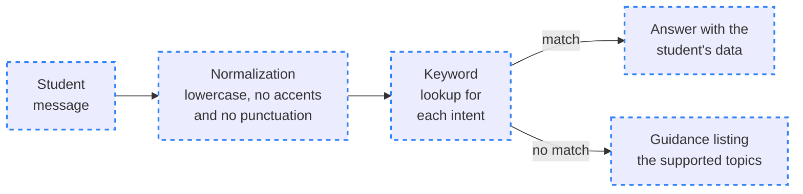
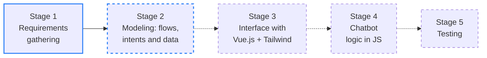

<div align="center">

# ⛈️ STORM

> 🌐 Leia em [Português](./README.md)

<a href="#-how-storm-will-answer"></a>

[](#️-development-stages)
[](./LICENSE)
[](./Pre-Projeto_STORM.pdf)
[](https://github.com/briandevbr/STORM/commits/main)

`Vue.js + Tailwind CSS (planned) · keyword-based chatbot · MIT`

**[📄 Read the pre-project](./Pre-Projeto_STORM.pdf)** &nbsp;·&nbsp; **[🖼️ See the wireframe](./Wireframe_STORM.pdf)**

</div>

**STORM** is a virtual assistant designed for the Student Portal: instead of clicking through several screens, students ask in the chat and get their semester schedule, the tuition due date and their expected graduation. This repository holds the pre-project of a group assignment given by Prof. Alamy. **Pre-project:** the documentation and the wireframe are done; the code for the portal and the chatbot has not started yet.

> [!TIP]
> **New here?** Start with the [pre-project](./Pre-Projeto_STORM.pdf) (in Portuguese): in 4 pages it explains the problem, the goals, the methodology and what STORM is expected to deliver.

---

## 📑 Table of Contents

- [🗂️ Project Structure](#️-project-structure)
- [🗂️ Project Structure - tree](#️-project-structure---tree)
- [🧠 How STORM will answer](#-how-storm-will-answer)
- [🖼️ Planned screens](#️-planned-screens)
- [🛣️ Development stages](#️-development-stages)
- [⚙️ Technologies used](#️-technologies-used)
- [🚀 How to run](#-how-to-run)
- [🤝 Contributing](#-contributing)
- [📄 License](#-license)

---

## 🗂️ Project Structure

| Path | Description |
|---|---|
| `Pre-Projeto_STORM.pdf` | 4-page pre-project in ABNT format (Portuguese): introduction, general and specific goals, rationale, methodology and expected results |
| `Wireframe_STORM.pdf` | 2-page wireframe: home screen on desktop with STORM open (Figure 1), home screen and chat on mobile (Figure 2) and Table 1, which explains the 8 numbered elements |
| `assets/` | Animated header banner in SVG, in Portuguese (`banner-chuva.svg`) and English (`banner-chuva.en.svg`): rain, clouds, lightning and the project's three lines, animated with CSS only, no library |
| `LICENSE` | The project's MIT license text |
| `README.en.md` | This documentation in English |
| `README.md` | This documentation in Portuguese |

---

## 🗂️ Project Structure - tree

```
🗂️
├── 📁 assets
│  ├── 🖼️ banner-chuva.en.svg
│  └── 🖼️ banner-chuva.svg
├── 🗒️ LICENSE
├── 📄 Pre-Projeto_STORM.pdf
├── 🇺🇸 README.en.md
├── 🇧🇷 README.md
└── 📄 Wireframe_STORM.pdf
```

---

## 🧠 How STORM will answer

The chatbot does not use generative AI: it recognizes the intent of a message through keywords. It cleans the text before comparing, so "Quando eu me formo?" and "quando eu me formo" ("when do I graduate?") get the same answer.



<sub>Flow described in the pre-project's Methodology · dashed blue border = planned, no code yet</sub>

| Intent | Sample question (PT → EN) | What STORM answers |
|---|---|---|
| Tuition | "quando vence minha mensalidade?" → when is my tuition due? | Due date, status (paid, open or overdue) and how many days are left |
| Semester schedule | "quais aulas tenho hoje" → which classes do I have today | Courses the student is enrolled in, with days and times |
| Graduation forecast | "quando eu me formo?" → when do I graduate? | Share of the program completed and the expected graduation semester |
| Out of scope or empty | "qual o cardápio do RU?" → what's on the cafeteria menu? | A note that it can't answer, plus the three topics above |

<sub>Questions taken from the wireframe and the Expected Results. The prototype will run on simulated student, course and tuition data.</sub>

> [!NOTE]
> The pre-project's Rationale mentions due-date reminders by email and WhatsApp, but they are not part of the prototype: the Expected Results leave them, along with integration with the institution's real system, as future work.

---

## 🖼️ Planned screens

The [wireframe](./Wireframe_STORM.pdf) was made with the help of AI, in grayscale: it sets where each element goes, without fixing colors or visual identity. The data shown on the screens is illustrative.

| Screen | What it shows |
|---|---|
| Desktop (Figure 1) | Side menu, cards for next tuition payment, course progress and today's classes, and the STORM window docked on the right, answering about the due date |
| Mobile: home (Figure 2) | The same cards stacked, the menu collapsed under the ☰ button and a floating button that opens STORM |
| Mobile: chat (Figure 2) | Full-screen chat with schedule and graduation questions and one out-of-scope question, which STORM declines and redirects |

<details>
<summary>📋 See the 8 elements from Table 1</summary>

| No. | Element | Purpose |
|:---:|---|---|
| 1 | Top bar | Identifies the student and gives access to notifications and profile |
| 2 | Navigation menu | Leads to the portal's areas; on mobile, it is collapsed under the menu button |
| 3 | Summary cards | Show the next tuition payment, course progress and today's classes |
| 4 | STORM window | Chat area with the assistant, docked beside the content on desktop |
| 5 | Quick suggestions | Shortcuts to the three main queries: schedule, tuition and graduation |
| 6 | Message field | Where the student types the question and sends it to STORM |
| 7 | Floating button | Opens STORM full screen on mobile |
| 8 | Out-of-scope answer | STORM says it can't answer and points to the topics it covers |

</details>

---

## 🛣️ Development stages

The Methodology splits the work into 5 stages, each tested before moving to the next. The project is currently in the second one.



<sub>Blue border = done · dashed blue = in progress · dashed, no color = not started · dotted arrow = handoff not made yet</sub>

| Stage | Status |
|---|---|
| **1. Requirements gathering** | Done in the pre-project: STORM will cover semester schedule, tuition and graduation forecast |
| **2. Modeling** | In progress: the wireframe is ready; the conversation flows and the intent and keyword table are still missing |
| **3. Interface** | Not started: building the portal and the chat window with Vue.js and Tailwind CSS |
| **4. Chatbot logic** | Not started: normalization, keyword lookup and calculations such as days until the due date |
| **5. Testing** | Not started: the goal is to recognize at least 80% of the questions in the test script, plus checking the layout on mobile and desktop |

---

## ⚙️ Technologies used

Today the repository holds the documentation and the animated header banner. The rest of the stack is the one set in the pre-project's Methodology.

- [SVG](https://developer.mozilla.org/en-US/docs/Web/SVG) with [CSS animations](https://developer.mozilla.org/en-US/docs/Web/CSS/CSS_animations): the header's rain banner, which stops moving when the system asks for reduced motion
- [HTML](https://developer.mozilla.org/en-US/docs/Web/HTML) (planned: structure of the portal pages and the chat window)
- [CSS](https://developer.mozilla.org/en-US/docs/Web/CSS) and [Tailwind CSS](https://tailwindcss.com/docs) (planned: consistent look with utility classes and a layout that adapts to mobile and desktop)
- [JavaScript](https://developer.mozilla.org/en-US/docs/Web/JavaScript) (planned: chatbot logic and due-date and graduation calculations)
- [Vue.js](https://vuejs.org/guide/introduction.html) (planned: components for the portal, the chat window and the message bubble, with the screen updating when the data changes)

---

## 🚀 How to run

There is no code to run yet: for now, the project is read. Prerequisites: [Git](https://git-scm.com/) and a PDF reader.

```bash
git clone https://github.com/briandevbr/STORM.git
cd STORM
```

Open `Pre-Projeto_STORM.pdf` for the full proposal and `Wireframe_STORM.pdf` for the screens. Once the Interface stage starts, this section will cover installation and the command to start the portal.

---

## 🤝 Contributing

A classroom group assignment, not open to outside contributions at the moment. Changes go straight to `main`, and commits follow [Conventional Commits](https://www.conventionalcommits.org/en/v1.0.0/) written in Portuguese, as in the history:

```text
docs: adiciona documentação do projeto
feat(wire): adiciona wireframe do projeto
docs: adiciona README em português e inglês
```

Suggestions are welcome through [issues](https://github.com/briandevbr/STORM/issues).

---

## 📄 License

Distributed under the [MIT](./LICENSE) license: use, study and adapt it freely, keeping the copyright notice. The banner in `assets/` was made for the project and follows the same license.

---

<div align="center">
  <sub>Made by the STORM team 💙 · pre-project for Prof. Alamy</sub><br/>
  <sub>Ask STORM instead of searching the portal.</sub>
</div>
