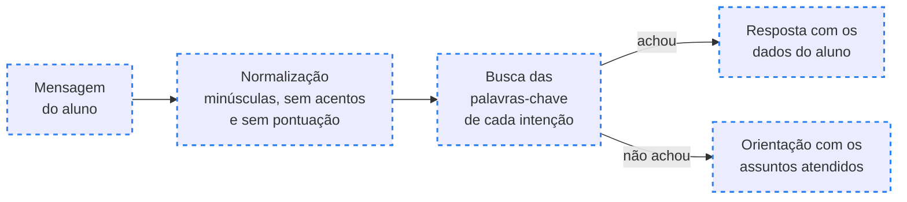
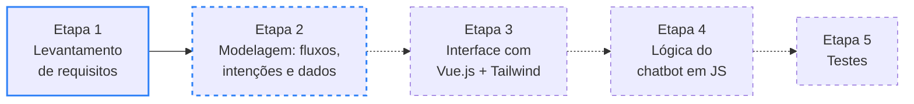

<div align="center">

# ⛈️ STORM

> 🌐 Read this in [English](./README.en.md)

<a href="#-como-o-storm-vai-responder"></a>

[](#️-etapas-do-desenvolvimento)
[](./LICENSE)
[](./Pre-Projeto_STORM.pdf)
[](https://github.com/briandevbr/STORM/commits/main)

`Vue.js + Tailwind CSS (planejado) · chatbot por palavras-chave · MIT`

**[📄 Ler o pré-projeto](./Pre-Projeto_STORM.pdf)** &nbsp;·&nbsp; **[🖼️ Ver o wireframe](./Wireframe_STORM.pdf)**

</div>

O **STORM** é um assistente virtual pensado para o Portal do Aluno: em vez de navegar por várias telas, o estudante pergunta no chat e recebe a grade do semestre, o vencimento da mensalidade e a previsão de formatura. Este repositório guarda o pré-projeto do trabalho em grupo proposto pelo Prof. Alamy. **Pré-projeto:** a documentação e o wireframe estão prontos; o código do portal e do chatbot ainda não começou.

> [!TIP]
> **Chegou agora?** Comece pelo [pré-projeto](./Pre-Projeto_STORM.pdf): em 4 páginas ele explica o problema, os objetivos, a metodologia e o que se espera do STORM ao final.

---

## 📑 Sumário

- [🗂️ Estrutura do Projeto](#️-estrutura-do-projeto)
- [🗂️ Estrutura do Projeto - tree](#️-estrutura-do-projeto---tree)
- [🧠 Como o STORM vai responder](#-como-o-storm-vai-responder)
- [🖼️ Telas planejadas](#️-telas-planejadas)
- [🛣️ Etapas do desenvolvimento](#️-etapas-do-desenvolvimento)
- [⚙️ Tecnologias usadas](#️-tecnologias-usadas)
- [🚀 Como rodar](#-como-rodar)
- [🤝 Contribuindo](#-contribuindo)
- [📄 Licença](#-licença)

---

## 🗂️ Estrutura do Projeto

| Caminho                 | Descrição                                                                                                                                                                                        |
| ----------------------- | ------------------------------------------------------------------------------------------------------------------------------------------------------------------------------------------------ |
| `Pre-Projeto_STORM.pdf` | Pré-projeto em 4 páginas, com formatação ABNT: introdução, objetivos geral e específicos, justificativa, metodologia e resultados esperados                                                      |
| `Wireframe_STORM.pdf`   | Wireframe em 2 páginas: tela inicial no computador com o STORM aberto (Figura 1), tela inicial e conversa no celular (Figura 2) e o Quadro 1, que explica os 8 elementos numerados               |
| `assets/`               | Banner animado do cabeçalho em SVG, em português (`banner-chuva.svg`) e em inglês (`banner-chuva.en.svg`): chuva, nuvens, raios e as três frases do projeto, animados só com CSS, sem biblioteca |
| `LICENSE`               | Texto da licença MIT do projeto                                                                                                                                                                  |
| `README.en.md`          | Esta documentação em inglês                                                                                                                                                                      |
| `README.md`             | Esta documentação em português                                                                                                                                                                   |

---

## 🗂️ Estrutura do Projeto - tree

```
🗂️
├── 📁 assets
│  ├── 🖼️ banner-chuva.en.svg
│  └── 🖼️ banner-chuva.svg
├── 🗒️ LICENSE
├── 📄 Pre-Projeto_STORM.pdf
├── 🇺🇸 README.en.md
├── 🇧🇷 README.md
└── 📄 Wireframe_STORM.pdf
```

---

## 🧠 Como o STORM vai responder

O chatbot não usa IA generativa: ele reconhece a intenção da mensagem por palavras-chave. Antes de comparar, limpa o texto, então "Quando eu me formo?" e "quando eu me formo" caem na mesma resposta.



<sub>Fluxo descrito na Metodologia do pré-projeto · borda azul tracejada = planejado, ainda sem código</sub>

| Intenção                | Pergunta de exemplo               | O que o STORM responde                                                         |
| ----------------------- | --------------------------------- | ------------------------------------------------------------------------------ |
| Mensalidades            | "quando vence minha mensalidade?" | Data de vencimento, status (paga, em aberto ou atrasada) e quantos dias faltam |
| Grade do semestre       | "quais aulas tenho hoje"          | Disciplinas em que o aluno está matriculado, com dias e horários               |
| Previsão de formatura   | "quando eu me formo?"             | Percentual do curso concluído e semestre previsto para a formatura             |
| Fora do escopo ou vazia | "qual o cardápio do RU?"          | Aviso de que não sabe responder e sugestão dos três assuntos acima             |

<sub>Perguntas tiradas do wireframe e dos Resultados Esperados. O protótipo vai trabalhar com dados simulados de alunos, disciplinas e mensalidades.</sub>

> [!NOTE]
> A Justificativa do pré-projeto cita avisos de vencimento por e-mail e WhatsApp, mas isso não entra no protótipo: os Resultados Esperados deixam essa parte, junto com a integração ao sistema real da instituição, como evolução futura.

---

## 🖼️ Telas planejadas

O [wireframe](./Wireframe_STORM.pdf) foi gerado com auxílio de IA, em tons de cinza: ele define onde cada elemento fica, sem fixar cores nem identidade visual. Os dados que aparecem nas telas são ilustrativos.

| Tela                             | O que mostra                                                                                                                                        |
| -------------------------------- | --------------------------------------------------------------------------------------------------------------------------------------------------- |
| Computador (Figura 1)            | Menu lateral, cartões de próxima mensalidade, progresso do curso e aulas do dia, e a janela do STORM fixa à direita, respondendo sobre o vencimento |
| Celular: tela inicial (Figura 2) | Os mesmos cartões empilhados, o menu recolhido no botão ☰ e um botão flutuante que abre o STORM                                                    |
| Celular: conversa (Figura 2)     | Chat em tela cheia com perguntas de grade e de formatura e uma pergunta fora do escopo, que o STORM recusa e redireciona                            |

<details>
<summary>📋 Ver os 8 elementos do Quadro 1</summary>

| Nº  | Elemento                | Função                                                                     |
| :-: | ----------------------- | -------------------------------------------------------------------------- |
|  1  | Barra superior          | Identifica o aluno e dá acesso às notificações e ao perfil                 |
|  2  | Menu de navegação       | Leva às áreas do portal; no celular, fica recolhido no botão de menu       |
|  3  | Cartões de resumo       | Mostram a próxima mensalidade, o progresso do curso e as aulas do dia      |
|  4  | Janela do STORM         | Área de conversa com o assistente, fixa ao lado do conteúdo no computador  |
|  5  | Sugestões rápidas       | Atalhos para as três consultas principais: grade, mensalidades e formatura |
|  6  | Campo de mensagem       | Onde o aluno digita a dúvida e a envia ao STORM                            |
|  7  | Botão flutuante         | Abre o STORM em tela cheia no celular                                      |
|  8  | Resposta fora do escopo | O STORM avisa que não sabe responder e indica os assuntos que atende       |

</details>

---

## 🛣️ Etapas do desenvolvimento

A Metodologia divide o trabalho em 5 etapas, cada uma testada antes de passar à próxima. Hoje o projeto está na segunda.



<sub>Borda azul = concluída · azul tracejada = em andamento · tracejada sem cor = não iniciada · seta pontilhada = passagem ainda não feita</sub>

| Etapa                             | Situação                                                                                                                      |
| --------------------------------- | ----------------------------------------------------------------------------------------------------------------------------- |
| **1. Levantamento de requisitos** | Concluída no pré-projeto: o STORM vai atender grade curricular, mensalidades e previsão de conclusão                          |
| **2. Modelagem**                  | Em andamento: o wireframe está pronto; faltam os fluxos de conversa e a tabela de intenções e palavras-chave                  |
| **3. Interface**                  | Não iniciada: construção do portal e da janela do chat com Vue.js e Tailwind CSS                                              |
| **4. Lógica do chatbot**          | Não iniciada: normalização, busca de palavras-chave e cálculos como dias até o vencimento                                     |
| **5. Testes**                     | Não iniciada: a meta é reconhecer pelo menos 80% das perguntas do roteiro, além de checar o layout no celular e no computador |

---

## ⚙️ Tecnologias usadas

Hoje o repositório tem a documentação e o banner animado do cabeçalho. O resto da stack é o definido na Metodologia do pré-projeto.

- [SVG](https://developer.mozilla.org/pt-BR/docs/Web/SVG) com [animações CSS](https://developer.mozilla.org/pt-BR/docs/Web/CSS/CSS_animations): banner de chuva do cabeçalho, que para de se mexer quando o sistema pede para reduzir movimento
- [HTML](https://developer.mozilla.org/pt-BR/docs/Web/HTML) (planejado: estrutura das páginas do portal e da janela de conversa)
- [CSS](https://developer.mozilla.org/pt-BR/docs/Web/CSS) e [Tailwind CSS](https://tailwindcss.com/docs) (planejado: visual padronizado com classes utilitárias e layout que se adapta ao celular e ao computador)
- [JavaScript](https://developer.mozilla.org/pt-BR/docs/Web/JavaScript) (planejado: lógica do chatbot e cálculos de vencimento e previsão de conclusão)
- [Vue.js](https://vuejs.org/guide/introduction.html) (planejado: componentes do portal, da janela do chat e do balão de mensagem, com a tela atualizada quando os dados mudam)

---

## 🚀 Como rodar

Ainda não há código para executar: por enquanto, o projeto é lido. Pré-requisitos: [Git](https://git-scm.com/) e um leitor de PDF.

```bash
git clone https://github.com/briandevbr/STORM.git
cd STORM
```

Abra o `Pre-Projeto_STORM.pdf` para ler a proposta completa e o `Wireframe_STORM.pdf` para ver as telas. Quando a etapa de Interface começar, esta seção passa a trazer a instalação e o comando para subir o portal.

---

## 🤝 Contribuindo

Trabalho em grupo de sala de aula, sem contribuição externa no momento. As mudanças entram direto na `main`, e os commits seguem o padrão [Conventional Commits](https://www.conventionalcommits.org/pt-br/v1.0.0/) em português, como no histórico:

```text
docs: adiciona documentação do projeto
feat(wire): adiciona wireframe do projeto
docs: adiciona README em português e inglês
```

Sugestões são bem-vindas pelas [issues](https://github.com/briandevbr/STORM/issues).

---

## 📄 Licença

Distribuído sob a licença [MIT](./LICENSE): use, estude e adapte à vontade, mantendo o aviso de copyright. O banner em `assets/` foi feito para o projeto e segue a mesma licença.

---

<div align="center">
  <sub>Feito pelo time STORM 💙 · pré-projeto para o Prof. Alamy</sub><br/>
  <sub>Pergunte ao STORM em vez de procurar no portal.</sub>
</div>
